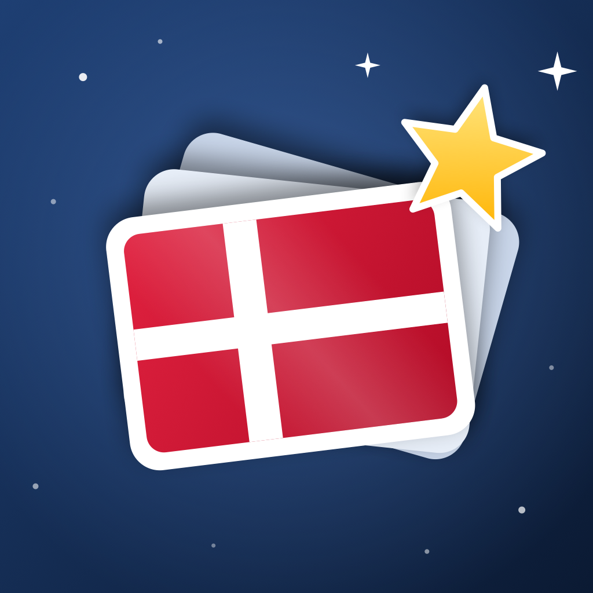

# Danish Vocab 🇩🇰



A native iOS app for learning the most used Danish words with pictures, pronunciation and a bit of gamification.

Every word has an emoji, an SF Symbol or a small hand-drawn picture to help it stick. You can hear it spoken in Danish and see its grammar (en/et, plural, verb tenses, adjective forms) along with an example sentence.

## Features

- **1950 words in four levels**

  | Pack | Words | Contents |
  |---|---|---|
  | Beginner | 200 | 100 nouns, 100 verbs |
  | Elementary | 250 | 100 nouns, 75 verbs, 75 adjectives |
  | Intermediate | 500 | 160 nouns, 120 verbs, 100 adjectives, 120 small words |
  | Advanced | 1000 | 409 nouns, 250 verbs, 200 adjectives, 141 small words |

  "Small words" are numbers, pronouns, question words, prepositions, adverbs, linking words and everyday phrases.
- **Flashcards:** see the picture, flip the card, then mark "Again" or "Knew it".
- **Quizzes:** three modes (picture → word, word → picture, listen → picture).
- **Spaced repetition:** Leitner boxes bring back the words you get wrong sooner.
- **Gamification:** XP and levels, combo bonuses, a daily streak and badges.
- **Dictionary of ~25,000 words:** the 1950 learning words plus ~23,000 more from Wiktionary. Each has its English meanings, en/et, inflected forms, pronunciation (IPA where available) and synonyms/antonyms. Search works both ways (Danish ⇄ English), finds inflected forms (*spiste* → *at spise*) and works without æ/ø/å (*aeble*, *kobe*).
- **Pronunciation:** every word and every example sentence is recorded by a native Danish voice ("Søren"), generated with [ElevenLabs](https://elevenlabs.io). The recordings are bundled in the app, so it works offline.

## Tech stack

- Swift 6, SwiftUI, SwiftData (iOS 17+)
- AVFoundation for speech
- Swift Testing for unit tests
- No third-party dependencies

## Getting started

Requirements: Xcode 16 or later and an iOS 17+ simulator or device.

```bash
git clone https://github.com/oktayibis/danish-vocab.git
cd danish-vocab
open DanishVocab.xcodeproj
```

Choose a simulator and press ⌘R. To run on your own iPhone, set your team under **Signing & Capabilities**, or set `DEVELOPMENT_TEAM` in `project.yml`.

The Xcode project is generated from `project.yml` with [XcodeGen](https://github.com/yonaskolb/XcodeGen). After changing targets or settings, run:

```bash
xcodegen generate
```

## Running tests

```bash
xcodebuild -project DanishVocab.xcodeproj -scheme DanishVocab \
  -destination 'platform=iOS Simulator,name=iPhone 17' test
```

The tests check:
- the word counts in each pack
- that no word is duplicated
- that every word has the grammar forms it needs
- that every SF Symbol exists
- that every quiz question has four distinct answers
- the spaced repetition, XP and streak rules
- dictionary search

## Project structure

```
DanishVocab/
  Data/        Word packs as JSON (packs.json + one file per word type)
  Models/      Word, WordPack, SwiftData progress models
  Services/    Spaced repetition, gamification, quiz builder, dictionary search, speech
  Views/       Home, pack, flashcards, quiz, dictionary, badges, profile
  Audio/       Recordings: <word id>.mp3 (word) and <word id>-ex.mp3 (example sentence)
DanishVocabTests/
scripts/make_icon.swift        Draws the app icon with CoreGraphics
scripts/generate_audio.swift   Records the word clips with the ElevenLabs API
scripts/import_dictionary.swift  Builds Data/dictionary.json from Wiktionary
project.yml               XcodeGen project definition
```

### Adding words or packs

Packs are data only. To add one, add a JSON file to `DanishVocab/Data/` and list it in `packs.json`; no code changes are needed. Each entry looks like this:

```json
{"id":"beg.n.001","danish":"æble","english":"apple","partOfSpeech":"noun","article":"et","plural":"æbler",
 "category":"food","visual":{"type":"emoji","value":"🍎"},"exampleDa":"Jeg spiser et æble.","exampleEn":"I am eating an apple."}
```

### Recording pronunciations

The app plays `Audio/<word id>.mp3` (word) and `Audio/<word id>-ex.mp3` (example sentence) when they exist, and falls back to the device voice otherwise. To record clips for new or changed words, set `ELEVENLABS_API_KEY` (or put it in `~/.config/elevenlabs-mcp/.env`) and run:

```bash
swift scripts/generate_audio.swift --list-voices                    # pick a voice
swift scripts/generate_audio.swift --dry-run                        # count characters
ELEVENLABS_VOICE_ID=<voice id> swift scripts/generate_audio.swift              # words
ELEVENLABS_VOICE_ID=<voice id> swift scripts/generate_audio.swift --examples   # example sentences
```

`scripts/audio_manifest.json` records which text each clip was made from: up-to-date clips are skipped, and clips whose word or sentence changed are recorded again. The default model, `eleven_turbo_v2_5`, is forced to Danish (`language_code: da`), so short words like *to* (two) and *fire* (four) aren't read as English. Recording all 1950 words used about 3,000 credits, and their example sentences about 7,800.

### Rebuilding the dictionary

`DanishVocab/Data/dictionary.json` is generated from the Danish entries of English Wiktionary (the [kaikki.org](https://kaikki.org/dictionary/Danish/) extract) and ranked using the [FrequencyWords](https://github.com/hermitdave/FrequencyWords) Danish subtitle list:

```bash
curl -LO https://kaikki.org/dictionary/Danish/kaikki.org-dictionary-Danish.jsonl
curl -LO https://raw.githubusercontent.com/hermitdave/FrequencyWords/master/content/2018/da/da_50k.txt
swift -O scripts/import_dictionary.swift kaikki.org-dictionary-Danish.jsonl da_50k.txt
```

## How this project was built

This project was built with an **ADLC (AI-Driven Development Life Cycle)** approach. **All of the code was written by Claude Opus 5.5** (Anthropic) in Claude Code, including the word lists, the tests and the app icon. Oktay Ibis set the direction, made the product decisions and reviewed the results.

The word lists and example sentences were also generated by AI. They have been checked automatically for structure, but not yet fully reviewed by a native Danish speaker. Corrections are very welcome. Please open an issue or a pull request.

## License

The code is [MIT](LICENSE) © 2026 Oktay Ibis.

Data with its own license:
- `DanishVocab/Data/dictionary.json` is derived from [Wiktionary](https://en.wiktionary.org) and is available under [CC BY-SA 4.0](https://creativecommons.org/licenses/by-sa/4.0/). Changes to this file must be shared under the same license.
- The frequency ranking uses [FrequencyWords](https://github.com/hermitdave/FrequencyWords) (MIT).
- The recordings in `DanishVocab/Audio` were generated with [ElevenLabs](https://elevenlabs.io) on a paid plan.
